<p align="center">
  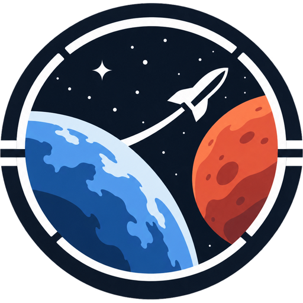
</p>

<h1 align="center">Cargo Window</h1>

<p align="center">Cargo planning for the first bases on the Moon and Mars. Built for the IEEE Lumen 2.0 "Beyond 2030" challenge.</p>

<p align="center"><strong><a href="https://cargo-window.nader.info/">Try it live: cargo-window.nader.info</a></strong></p>

A rocket to an off-world base has fixed room, and in 2035 every flight has more cargo waiting than space. On Earth a parcel that misses the truck goes tomorrow. To Mars, the next ship leaves in about 26 months. Cargo Window decides what flies using fixed, published rules, and shows what each decision costs the people waiting for it before launch.


## How it works

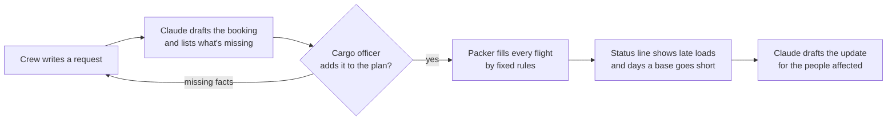

## Screenshots

| | |
|---|---|
| 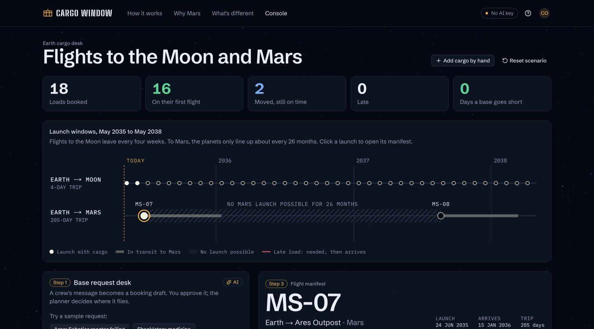 **The cargo desk** opens with one line that says whether any base will go short, and a card per base with its next rocket. | 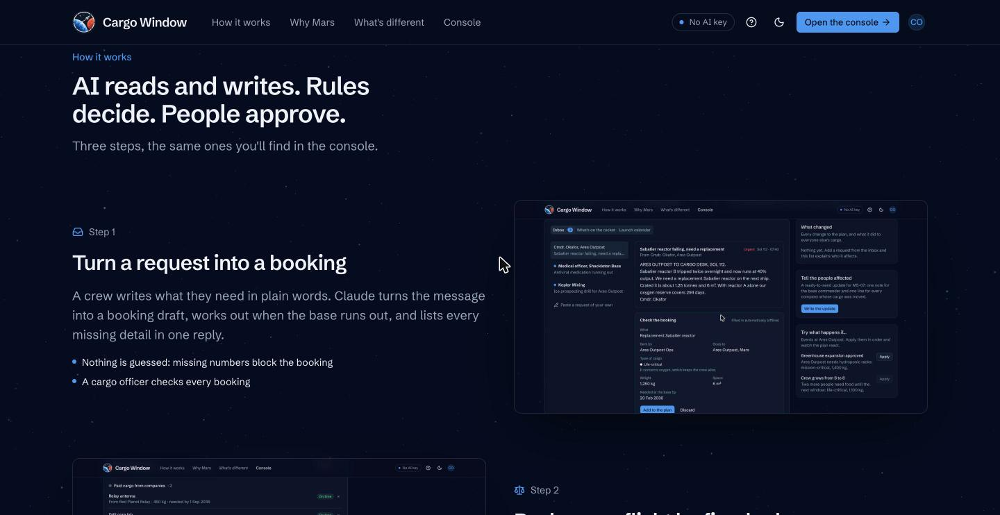 **The landing page** explains the idea in three steps, each with a real screenshot. |
|  **Turn into a booking**: a crew's message from the inbox becomes a booking to check. | 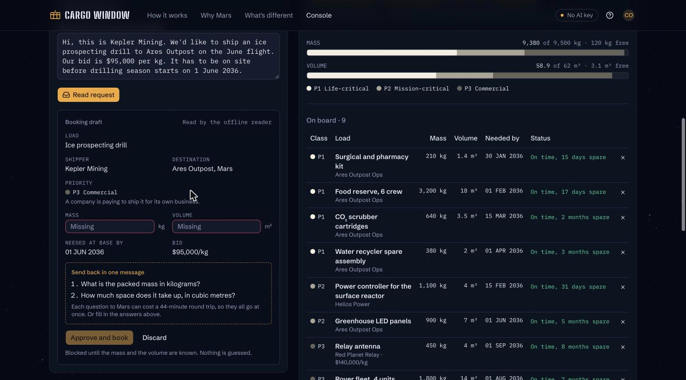 **Nothing is guessed.** Missing numbers keep "Add to the plan" off and become questions sent back in one message. |
|  **Every move has a reason** and a cost: the rover fleet waits 19 months for the next Mars rocket. |  **When a base will go short**, the status line and its card turn red, and "What changed" says why. |
| 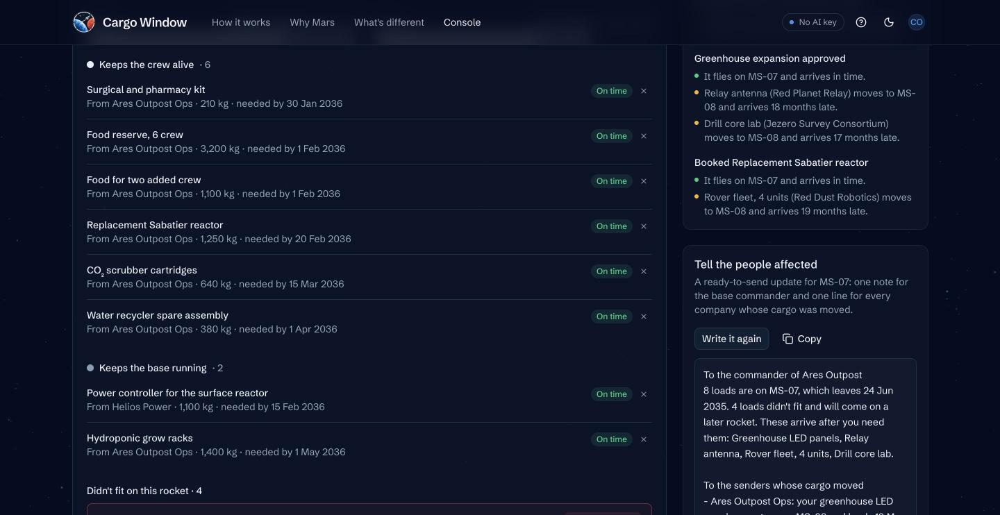 **Write the update** drafts the note to the commander and one line for every company whose cargo moved. | 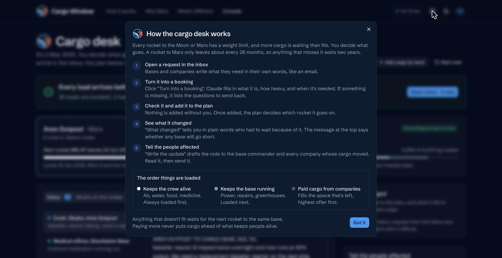 **"How it works"** opens a one-screen guide from any page. |
| 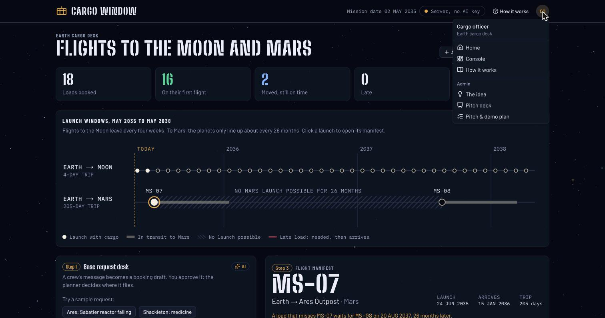 **The profile menu** leads to the console, the guide and the admin pages. | 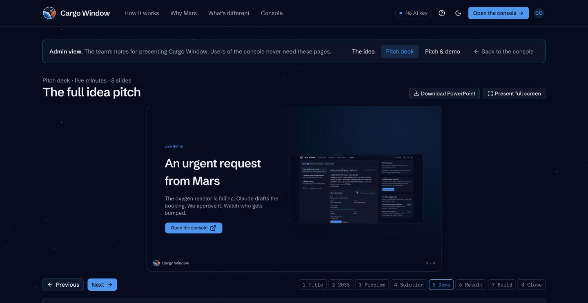 **The pitch deck**: previous and next, speaker notes, full screen, and a PowerPoint download. |
| 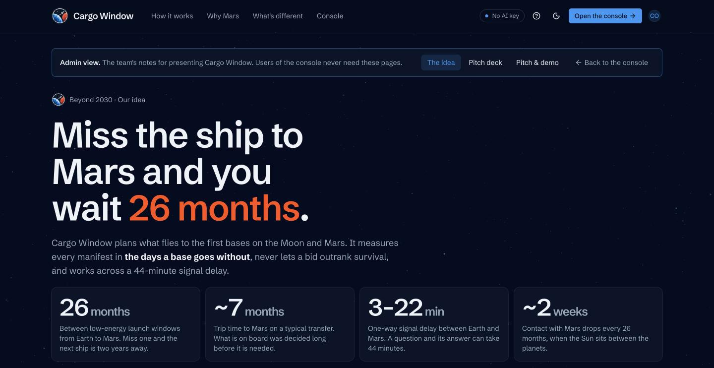 **The idea** answers the challenge's seven questions. | 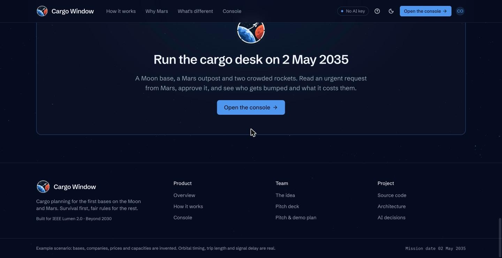 **Every page** shares the header and a footer with product, team and project links. |

### Light and dark

The app follows the system theme, and the sun/moon button in the header switches between light, dark and system. The colours come from the mission patch: deep navy, Earth blue and Mars red.

| Light | Dark |
|---|---|
| 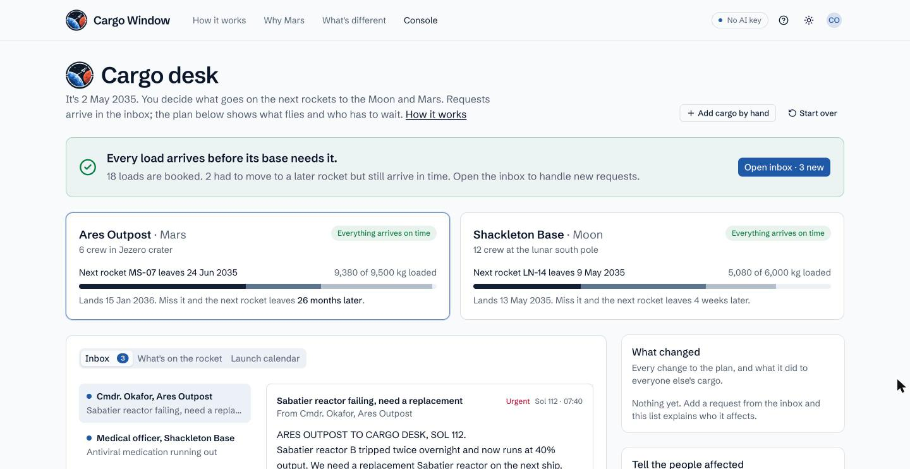 |  |
| 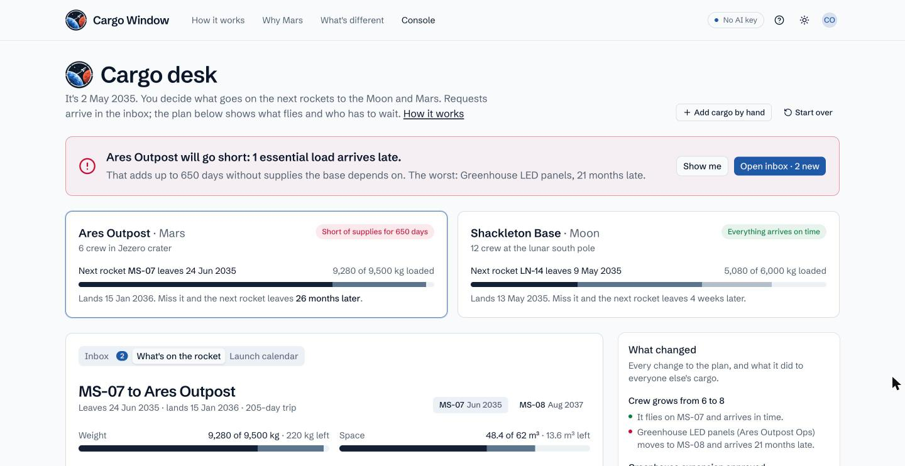 |  |

## What it does

| Part | What it does | Decided by |
|---|---|---|
| Inbox | Turns a crew's free-text message into a booking to check and puts every missing detail into one reply | Claude, checked by the server, added by a person |
| Packer | Builds each flight's manifest: life-critical first, then mission-critical, then commercial by bid | Fixed rules |
| Status line and base cards | Check every load against the date its base needs it, count the days a base goes short, and say in plain words who had to wait | Fixed rules |
| Manifest fingerprint | An 8-character code per manifest. The Earth server and the browser (the base copy) compare codes to confirm they agree. | Fixed rules |
| The update | Drafts the note to the commander and one line for each company whose cargo moved | Claude, sent by a person |

## What we created that wasn't already there

- A manifest is measured in **days a base goes short**, not in kilograms carried or revenue earned.
- **Money can't outrank survival:** bids only sort loads inside the commercial class.
- **Two planets can agree without negotiating:** the packer is deterministic, so Earth and a base compute the same manifest and compare fingerprints in one short message, across a delay of up to 44 minutes. The Python server and the TypeScript web app run independent copies, and a test proves they match.
- **A request desk built for delay** that asks every missing question at once and keeps working offline.

## The app

| Route | Purpose |
|---|---|
| `/` | Landing page that explains the idea, with a button into the console |
| `/console/` | The cargo desk: status line, base cards, inbox, what's on each rocket, launch calendar, what changed, the update, what-if events |
| `/admin/idea/`, `/admin/deck/`, `/admin/pitch/` | The team's pages: the idea in full, the pitch deck, and the pitch and demo plan. Reached through the profile menu. |

"How it works" in the header opens a step-by-step guide on every page. The header also carries the theme switch and the AI status: Claude online, No AI key, or Offline.

### The pitch deck and its PowerPoint

`/admin/deck/` presents the five-minute pitch as eight slides: Previous and Next, arrow keys, full screen, and what to say under each slide. **Download PowerPoint** builds `Cargo-Window-pitch.pptx` in the browser from the same slide definitions (`web/lib/deck.ts`), with the screenshots embedded and the speaker notes on every slide, so the on-screen deck and the file never drift apart.

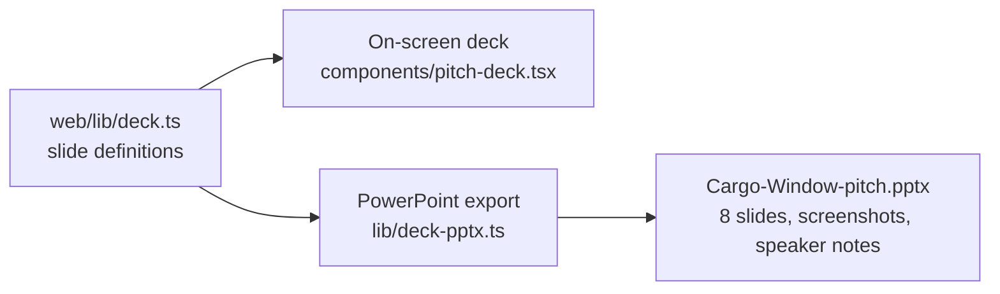

## Run it locally

Requires Python 3.12 or later and Node 22 or later. Node 23.6 or later also runs the parity test.

```bash
# Server
python3 -m venv .venv
.venv/bin/pip install -r backend/requirements-dev.txt
export ANTHROPIC_API_KEY=...        # optional: without it the offline reader is used

# Web app, built once and served by the server
cd web && npm ci && npm run build && cd ..
cd backend && ../.venv/bin/uvicorn app.main:app --reload
```

Open http://127.0.0.1:8000. Interactive API docs are at http://127.0.0.1:8000/docs. To work on the web app with hot reload, see [Development](docs/ARCHITECTURE.md#development).

## Test it

```bash
cd backend && ../.venv/bin/python -m pytest      # server, API, parity with the web app's packer
cd web && npm run lint && npm run build          # web app
```

The backend suite covers:
- the demo scenario's numbers (rover fleet 589 days late; days short 0, then 650);
- the API routes and the request desk's checks on Claude's answers;
- the rate limit;
- parity: `web/lib/engine.ts` and the Python packer produce identical fingerprints at every stage of the demo.

## Deploy

One container serves the API and the web app. The live version runs at https://cargo-window.nader.info/ with Claude connected.

- **Render:** create a Blueprint from this repository (`render.yaml`), then set `ANTHROPIC_API_KEY`.
- **Any container host:** `docker build -t cargo-window . && docker run -p 8000:8000 -e ANTHROPIC_API_KEY=... cargo-window`

## Docs

- [The idea](docs/IDEA.md): the challenge's seven questions answered, what's original, the 2030+ test.
- [Architecture](docs/ARCHITECTURE.md): pages, components, API, why there are two packers, fallbacks, configuration, development, deployment.
- [AI decisions](docs/AI_DECISIONS.md): where Claude is used and where it deliberately isn't, how its output is checked, failure modes, privacy and cost.

## Project layout

```
backend/app/     FastAPI server: models, schedule, packer, request desk, briefs, Claude client
backend/tests/   scenario, packer, API and parity tests
web/app/         Next.js routes: landing, console, admin pages
web/components/  console, header, footer, guide, deck, and shadcn/ui components
web/lib/         packer (base copy), offline reader, API client, scenario, deck slides and PowerPoint export
web/public/      the logo (brand/) and the screenshots used by the landing page, the deck and these docs
docs/            the idea, architecture and AI decisions
Dockerfile, render.yaml
```

## AI use (rule 12.5)

- **In the product:** Claude reads requests and drafts briefs, called from the FastAPI server with the Anthropic Python SDK. It never decides what flies. See [docs/AI_DECISIONS.md](docs/AI_DECISIONS.md).
- **To build it:** Claude Code, Anthropic's coding assistant (model Claude Opus 5.5), wrote most of the code, documentation and screenshots under the team's direction. The team reviewed the code and can explain every part of it.

## Credits (rule 12.4)

- Server: FastAPI, Pydantic, Uvicorn and the Anthropic Python SDK.
- Web app: Next.js, React, Tailwind CSS, shadcn/ui with Base UI, Lucide icons and Sonner.
- Fonts from Google Fonts: Schibsted Grotesk and IBM Plex Mono.
- The Cargo Window mission patch logo, provided by the team.
- PptxGenJS, which builds the PowerPoint download of the pitch deck.
- The FNV-1a hash, a public algorithm.

## Limits

The packer only checks mass and volume. It does not handle centre of gravity, hazardous goods, partial loads or return cargo. Bases, companies, people, prices and capacities are invented for the example scenario. Mars launch timing, trip length, signal delay and solar conjunction follow real orbital mechanics.
