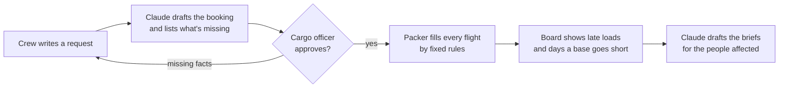

# Cargo Window

Cargo planning for the first bases on the Moon and Mars. Built for the IEEE Lumen 2.0 "Beyond 2030" challenge.

A rocket to an off-world base has fixed room, and in 2035 every flight has more cargo waiting than space. On Earth a parcel that misses the truck goes tomorrow. To Mars, the next ship leaves in about 26 months. Cargo Window decides what flies using fixed, published rules, and shows what each decision costs the people waiting for it before launch.


## How it works



## Screenshots

| | |
|---|---|
|  **The console** opens with a three-step guide, five counters and the launch timeline. |  **The request desk** turns a crew's message into a booking draft. |
|  **Nothing is guessed.** Missing numbers block the booking and become questions sent back in one message. |  **Every bump has a reason** and a consequence: the rover fleet waits 19 months. |
|  **Days a base goes short** and late loads drawn on the timeline. |  **The brief** for the commander and every bumped shipper. |
|  **The profile menu** leads to the guide and the admin pages. |  **The pitch deck** with next and previous, speaker notes and full screen. |

## What it does

| Part | What it does | Decided by |
|---|---|---|
| Request desk | Turns a crew's free-text message into a booking draft and puts every missing detail into one reply | Claude, checked by the server, approved by a person |
| Packer | Builds each flight's manifest: life-critical first, then mission-critical, then commercial by bid | Fixed rules |
| Consequence board | Checks every load against the date its base needs it, and counts the days a base goes short | Fixed rules |
| Manifest fingerprint | An 8-character code per manifest. The Earth server and the browser (the base copy) compare codes to confirm they agree. | Fixed rules |
| Briefs | Drafts the note to the commander and the message to each bumped shipper | Claude, sent by a person |

## What we created that wasn't already there

- A manifest is measured in **days a base goes short**, not in kilograms carried or revenue earned.
- **Money can't outrank survival:** bids only sort loads inside the commercial class.
- **Two planets can agree without negotiating:** the packer is deterministic, so Earth and a base compute the same manifest and compare fingerprints in one short message, across a delay of up to 44 minutes. The Python server and the TypeScript web app run independent copies, and a test proves they match.
- **A request desk built for delay** that asks every missing question at once and keeps working offline.

## The app

| Route | Purpose |
|---|---|
| `/` | Landing page that explains the idea, with a button into the console |
| `/console/` | The cargo desk: request desk, flight board, timeline, manifest, scenarios |
| `/admin/idea/`, `/admin/deck/`, `/admin/pitch/` | The team's pages: the idea in full, the pitch deck, and the pitch and demo plan. Reached through the profile menu. |

"How it works" in the header opens a step-by-step guide on every page.

## Run it locally

Requires Python 3.12 or later and Node 22 or later. Node 23.6 or later also runs the parity test.

```bash
# Server
python3 -m venv .venv
.venv/bin/pip install -r backend/requirements-dev.txt
export ANTHROPIC_API_KEY=...        # optional: without it the offline reader is used

# Web app, built once and served by the server
cd web && npm ci && npm run build && cd ..
cd backend && ../.venv/bin/uvicorn app.main:app --reload
```

Open http://127.0.0.1:8000. Interactive API docs are at http://127.0.0.1:8000/docs. To work on the web app with hot reload, see [Development](docs/ARCHITECTURE.md#development).

## Test it

```bash
cd backend && ../.venv/bin/python -m pytest      # server, API, parity with the web app's packer
cd web && npm run lint && npm run build          # web app
```

The backend suite covers:
- the demo scenario's numbers (rover fleet 589 days late; days short 0, then 650);
- the API routes and the request desk's checks on Claude's answers;
- the rate limit;
- parity: `web/lib/engine.ts` and the Python packer produce identical fingerprints at every stage of the demo.

## Deploy

One container serves the API and the web app.

- **Render:** create a Blueprint from this repository (`render.yaml`), then set `ANTHROPIC_API_KEY`.
- **Any container host:** `docker build -t cargo-window . && docker run -p 8000:8000 -e ANTHROPIC_API_KEY=... cargo-window`

## Docs

- [The idea](docs/IDEA.md): the challenge's seven questions answered, what's original, the 2030+ test.
- [Architecture](docs/ARCHITECTURE.md): pages, components, API, why there are two packers, fallbacks, configuration, development, deployment.
- [AI decisions](docs/AI_DECISIONS.md): where Claude is used and where it deliberately isn't, how its output is checked, failure modes, privacy and cost.

## Project layout

```
backend/app/     FastAPI server: models, schedule, packer, request desk, briefs, Claude client
backend/tests/   scenario, packer, API and parity tests
web/app/         Next.js routes: landing, console, admin pages
web/components/  console, header, guide, deck, and shadcn/ui components
web/lib/         packer (base copy), offline reader, API client, formatting, scenario
docs/            architecture and AI decisions
Dockerfile, render.yaml
```

## AI use (rule 12.5)

- **In the product:** Claude reads requests and drafts briefs, called from the FastAPI server with the Anthropic Python SDK. It never decides what flies. See [docs/AI_DECISIONS.md](docs/AI_DECISIONS.md).
- **To build it:** Claude Code, Anthropic's coding assistant (model Claude Opus 5.5), wrote most of the code, documentation and screenshots under the team's direction. The team reviewed the code and can explain every part of it.

## Credits (rule 12.4)

- Server: FastAPI, Pydantic, Uvicorn and the Anthropic Python SDK.
- Web app: Next.js, React, Tailwind CSS, shadcn/ui with Base UI, Lucide icons and Sonner.
- Fonts from Google Fonts: Barlow, Barlow Condensed, IBM Plex Mono and Big Shoulders Stencil.
- The FNV-1a hash, a public algorithm.

## Limits

The packer only checks mass and volume. It does not handle centre of gravity, hazardous goods, partial loads or return cargo. Bases, companies, people, prices and capacities are invented for the example scenario. Mars launch timing, trip length, signal delay and solar conjunction follow real orbital mechanics.
