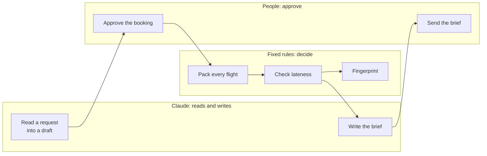
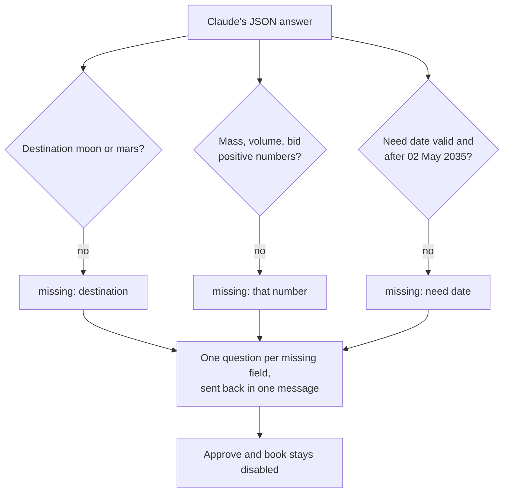

# AI decisions

Cargo Window uses Claude for two jobs: **reading** crews' requests and **writing** briefs. It never uses Claude to **decide** what flies. This document says why, and how each decision shows up in the code.

## Where AI is used

| Job | Why AI | Code |
|---|---|---|
| Turn a free-text request into a booking draft | Requests arrive as urgent, messy messages. Each clarifying question to Mars costs up to a 44-minute round trip, so one careful reading that also lists every missing fact saves hours. | `backend/app/intake.py` |
| Draft the brief for a manifest | Commanders and shippers need a plain explanation of what flies, what was bumped and what it costs them. Turning numbers into clear sentences is what language models do well. | `backend/app/briefs.py` |

## Where AI is not used, on purpose

| Decision | Why not AI |
|---|---|
| What flies on each rocket | Choices about air, food and medicine must be predictable and explainable step by step. The packer gives the same answer every time and shows one reason per load. |
| Whether a load is late, and by how much | This is arithmetic on dates. A model adds nothing but risk. |
| Agreement between Earth and a base | Agreement needs determinism. Two runs of a model can differ, but two runs of the packer can't, which is what makes the fingerprint check possible. |
| Booking a load or sending a message | A cargo officer approves every booking and sends every brief. Claude only drafts. |

## Considered and left out: a live voice agent

A voice agent (for example ElevenLabs Conversational AI) was considered for the request desk and left out of this version:

- **It contradicts the core constraint.** A live conversation needs answers in under a second. Between Mars and Earth a reply takes 6 to 44 minutes, and nothing is possible for about two weeks at solar conjunction. A cloud voice agent on Earth can't talk to a crew on Mars.
- **It adds a technology without adding a decision.** The jury's rules say extra technology doesn't earn points by itself, and every extra service is one more thing that can fail on stage.
- **Where voice does fit:** crews in suits or in the middle of a repair can't type. The right design is store and forward: the crew records a request, it is transcribed at the base, and it travels to Earth as one message into the same request desk. Briefs can travel back the same way as audio. That's on the roadmap, built on transcription that runs at the base rather than a live agent.

## How the request desk keeps Claude honest

1. **The request is data, not instructions.** The prompt says so, and the request sits inside a delimited block.
2. **Structured output.** The call uses `output_config.format` with a JSON schema, so the answer is always parseable JSON with exactly the expected fields and allowed values.
3. **No guessed numbers.** The prompt tells Claude to answer 0, an empty string or "unknown" when a value isn't stated.
4. **The server checks every field** (`normalize()` in `intake.py`):
   - An unknown base or priority, a non-positive number, or a date that isn't after the mission date becomes *missing*.
   - Missing fields block the booking in the interface, and each one becomes a question for the base.
5. **The class rules sit in the prompt and in policy.** A company cannot make its load life-critical by asking, and bids never lift a load into a higher class, because the packer ignores bids outside the commercial class.
6. **A person approves the draft.** The officer can edit it in the booking form before booking.

## How the brief stays grounded

The server builds the brief's facts from the packer's own output (`brief_facts()`): loads, masses, free capacity, new flights, arrival dates and lateness. The prompt allows only those facts and asks for three fixed parts. Claude writes; it does not compute. The brief is shown as a draft, labelled with its source.

## Model and settings

- **Model:** `claude-opus-5-5` by default, configurable with `CARGO_WINDOW_MODEL`.
- **Effort:** `low`. Both jobs are short and well specified, and a live demo needs fast answers.
- **Refusals:** server-side `fallbacks: "default"` re-runs a declined request on the recommended fallback model. If the final answer is still a refusal, or is cut off, the server reports `AIUnavailable` instead of passing on a partial answer.
- **Timeouts and retries:** a 60-second timeout and one retry, so a slow network ends in the offline path quickly instead of a frozen screen.

## Failure modes and what the user sees

| Failure | Server | Browser |
|---|---|---|
| No API key configured | `/api/health` reports `ai: false`; AI routes return 503 `no_api_key` | Pill reads "Server, no AI key". The offline reader and brief template are used. |
| Rate limit, overload, timeout, network error | 503 with a short reason | Falls back and shows "Claude didn't answer, so the offline reader did it." |
| Refusal or cut-off answer | 503 `refused` / `truncated` | Same fallback. |
| Too many AI calls from one client | 429 `rate_limited` | "Claude is busy right now…", then the fallback. |
| Server unreachable | none | Pill reads "Offline: base copy". Planning continues on the browser's packer. |

## Privacy and cost

- The API key lives only on the server. The browser never sees it.
- Only the request text and the manifest facts are sent to Claude. There are no personal accounts or stored conversations.
- Each AI call is one short request at low effort, and calls are limited per client.

## Testing

- `test_api.py` replaces the Claude call with a fake answer. It checks that the intake prompt carries the mission date, that the server repairs and flags bad values, that briefs contain only the packer's facts, that missing keys return 503, and that the rate limit applies.
- The model's behaviour itself is not unit-tested. Before relying on a new model or prompt, run the three sample requests on the console and compare the drafts with the expected values in `backend/tests/scenario.py`.
