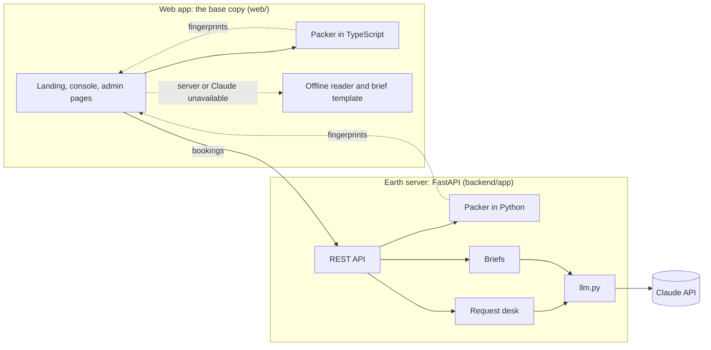
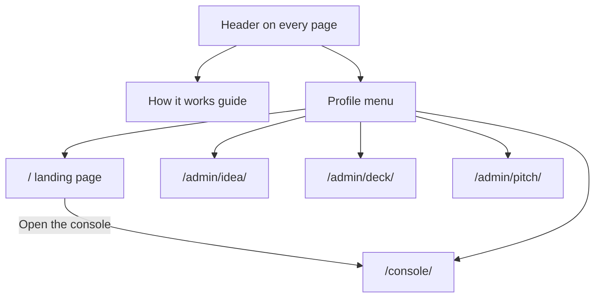
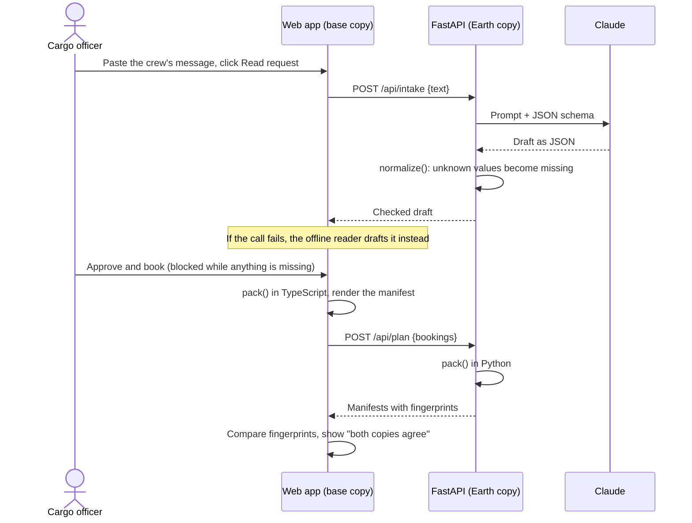
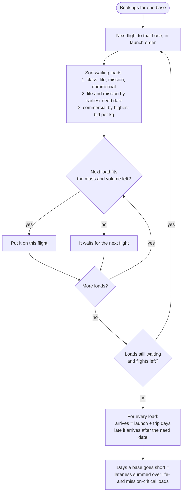
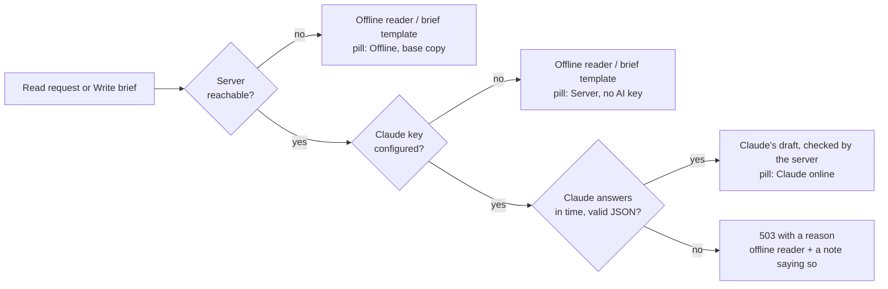

# Architecture

Cargo Window has two copies of one planner. The **Earth copy** is a Python server, and it also holds the Claude key. The **base copy** is the web app in the browser, which carries the same packing rules in TypeScript. They exchange bookings and compare manifest fingerprints. If the server can't be reached, the web app keeps planning on its own.



## Pages

| Route | Who it's for | What it shows |
|---|---|---|
| `/` | Anyone | Landing page: the problem, how it works, what's new, and a button into the console. |
| `/console/` | Cargo officers | The working tool: a three-step introduction, summary counters, the launch timeline, the request desk, the flight board, demo scenarios and the selected flight's manifest. |
| `/admin/idea/` | The team | The challenge's seven questions answered, originality, technology choices. |
| `/admin/deck/` | The team | The five-minute pitch as slides, with speaker notes and full-screen presenting. |
| `/admin/pitch/` | The team | Run sheet, demo click path, scoring, jury questions, stage checklist. |

The admin pages are reached through the profile menu (the avatar at the top right), next to "How it works", which opens the guide from any page.



| | |
|---|---|
|  |  |
|  |  |

## Components

| Path | What it does |
|---|---|
| `backend/app/models.py` | Pydantic models for bookings, flights, manifests, placements, drafts and the API's requests and responses. Every request is validated here before any logic runs. |
| `backend/app/schedule.py` | The shared schedule: the two bases, trip times and the flights (Moon every 28 days; Mars in June 2035 and August 2037). |
| `backend/app/packer.py` | The packing rules, the need-date check, days a base goes short, and the manifest fingerprint. Deterministic, with no I/O and no AI. |
| `backend/app/intake.py` | The request desk: the prompt, the JSON schema Claude must answer in, and `normalize()`, which checks every field Claude returns. |
| `backend/app/briefs.py` | Turns a manifest into plain facts and asks Claude for the brief. |
| `backend/app/llm.py` | The only module that calls Claude. Every failure becomes `AIUnavailable`. |
| `backend/app/main.py` | The FastAPI app: four API routes, a per-client limit on AI calls, and hosting of the built web app. |
| `web/lib/engine.ts` | The packer as the base copy. It has no imports and only uses TypeScript syntax that Node can strip, so the parity test runs it directly. |
| `web/lib/offline.ts` | The offline request reader, the draft checks and the brief template used when Claude or the server is unavailable. |
| `web/lib/api.ts` | The client for the server's API. |
| `web/lib/deck.ts`, `web/lib/deck-pptx.ts` | The pitch deck's slides as data, and the PptxGenJS export that turns them into a `.pptx` in the browser. |
| `web/components/app-header.tsx`, `app-footer.tsx` | The shared header (navigation, AI status, guide, profile menu) and footer. |
| `web/components/console/` | The console: request desk, flight board, manifest panel, timeline, scenarios, manual booking. |
| `web/components/ui/` | shadcn/ui components (Base UI primitives styled with Tailwind). |

## API

| Method and path | Body | Returns | Notes |
|---|---|---|---|
| `GET /api/health` | none | `{ai, model}` | Whether a Claude key is configured. |
| `POST /api/plan` | `{bookings}` | Manifests, placements, days short | Pure computation; never calls Claude. |
| `POST /api/intake` | `{text}` | A checked booking draft | 503 when Claude is unavailable; the web app then uses its offline reader. |
| `POST /api/brief` | `{bookings, flight_id}` | `{text}` | 503 when Claude is unavailable; the web app then uses its template. |

FastAPI publishes interactive API docs at `/docs` on the running server.

## How a request flows



## The packing rules



## Design decisions

**The server is stateless.** The web app holds the scenario and sends the bookings with every call. That keeps the prototype free of a database and makes every response reproducible from its request. A production version would keep signed bookings in a shared store, so several officers can work on the same flights.

**Two packers on purpose.** The packing rules exist in Python and TypeScript because the story needs two independent copies: Earth and a base that can be 22 light-minutes away or out of contact. The copies must agree exactly, so:

- both sort in the same order, with ties keeping input order;
- both round volumes to one decimal, halves up;
- both hash the same text per UTF-16 unit with FNV-1a;
- `backend/tests/test_parity.py` runs `web/lib/engine.ts` in Node and the Python packer on every stage of the demo, and fails on any differing fingerprint.

The console shows, under each manifest, whether the Earth server's fingerprint matches the browser's.

**Graceful fallback, in two layers.** If Claude fails, the server returns 503 with a short reason and the web app falls back to its offline reader or brief template. If the server is unreachable, the web app plans alone with its own packer. The demo can lose the network and still run.



**One module talks to Claude.** `llm.py` sets the model, effort, fallbacks and error handling once. Prompts live next to the feature that uses them.

**One deployable.** Next.js builds to static files (`output: "export"`), and the FastAPI server hosts them next to the API. One container, one URL, no cross-origin setup in production.

**Cost and abuse.** AI routes are limited per client (`CARGO_WINDOW_AI_PER_MINUTE`, default 20). Text sent to Claude is capped at 4,000 characters, and bookings at 500 per request. Behind a proxy, every client shares the proxy's address, so the limit is effectively global. That is acceptable for a demo; production would key it on the signed-in user.

## Configuration

| Variable | Where | Default | Purpose |
|---|---|---|---|
| `ANTHROPIC_API_KEY` | server | unset | Enables Claude. Without it the app runs fully, using the offline reader and brief template. |
| `CARGO_WINDOW_MODEL` | server | `claude-opus-5-5` | The Claude model the server calls. |
| `CARGO_WINDOW_AI_PER_MINUTE` | server | `20` | AI calls each client may make per minute. |
| `CARGO_WINDOW_WEB_DIR` | server | `web/out` | Where the built web app is. |
| `CORS_ORIGINS` | server | unset | Comma-separated origins. Needed only when the web app runs elsewhere, such as the Next.js dev server. |
| `NEXT_PUBLIC_API_URL` | web build | empty | Base URL of the API. Empty means the same origin, which is how production runs. |

## Development

Run the API and the Next.js dev server side by side:

```bash
# terminal 1: API on :8000, allowing the dev server's origin
cd backend && CORS_ORIGINS=http://localhost:3000 ../.venv/bin/uvicorn app.main:app --reload

# terminal 2: web app on :3000, talking to the API
cd web && NEXT_PUBLIC_API_URL=http://127.0.0.1:8000 npm run dev
```

For a production-like run, build the web app (`cd web && npm run build`) and start only the API. It serves `web/out` on the same port.

## Deployment

The `Dockerfile` has two stages: Node builds the web app, then the Python image copies `web/out` next to the server. `render.yaml` deploys it on Render as a single web service: create a Blueprint from the repository and set `ANTHROPIC_API_KEY` in the dashboard. Any container host works the same way, as long as the app listens on `$PORT`.
