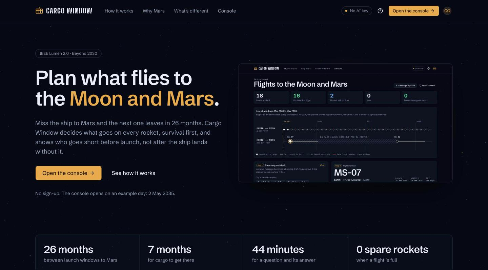
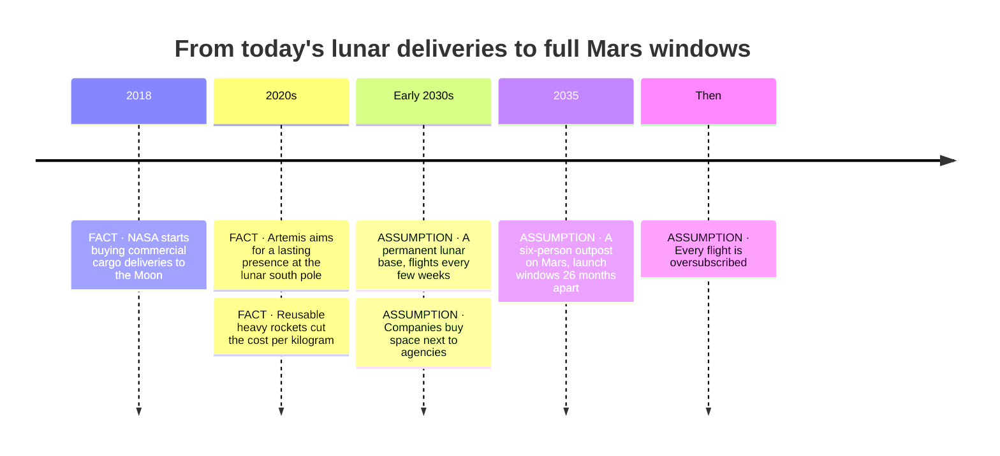
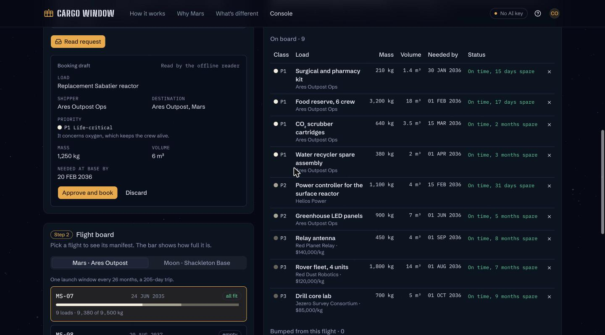
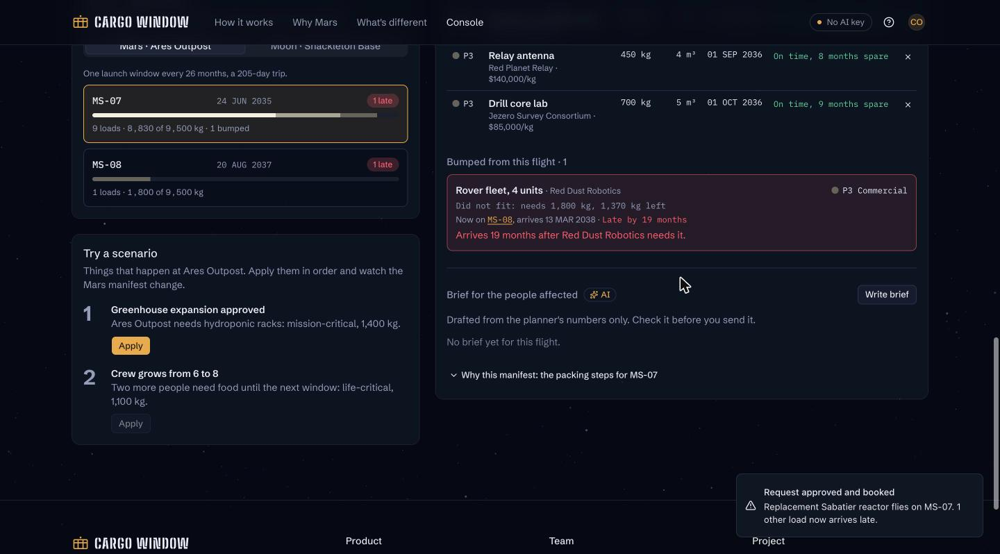
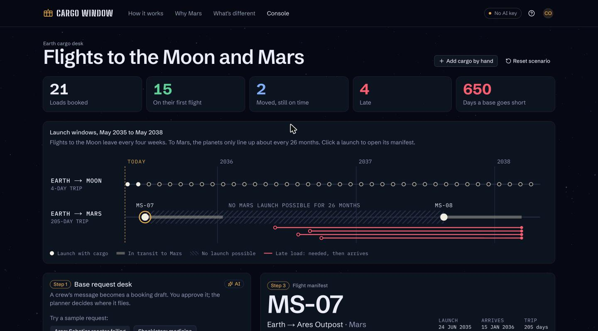

# The idea

Cargo Window answers the seven questions the Beyond 2030 challenge asks, in order. The same content is in the app under the profile menu → Admin → The idea.

## 1. What problem we tackle

Every rocket to an off-world base has a fixed mass and volume, and in 2035 every flight has more cargo waiting than room. Someone has to choose what goes. On Earth that choice is cheap to get wrong, because the next truck leaves tomorrow. To Mars, the next ship leaves in about 26 months, so the manifest decides who goes without for two years.

Three things break at once:
- **Fairness:** there are no shared, published rules for who gets bumped.
- **Foresight:** nobody sees that a bumped load leaves a base short until the ship lands without it.
- **Requests:** crews ask over a delayed link, and every clarifying question to Mars costs up to 44 minutes.

## 2. Who it affects

| Who | What goes wrong for them today |
|---|---|
| Base crews | A spare part they needed lands on the next ship, months after the old one fails. |
| Base commanders | They learn about a shortage when the ship arrives without it. |
| Cargo officers on Earth | Requests arrive as messy messages over a delayed link. |
| Flight operators | They must fill every kilogram and justify every refusal. |
| Companies shipping cargo | They find out late that their load was bumped, with no reason given. |

## 3. Why it matters

- A CO₂ scrubber cartridge that misses the Mars window leaves a crew short of air-cleaning spares until the next one.
- Delivering cargo to the Moon costs hundreds of thousands of dollars per kilogram today. Wasted room is wasted money.
- Agencies and companies will only share flights if the rules are fair and the same for everyone.
- By the time a crew notices a part is missing, the window has closed.

## 4. How it emerges in the future

The 26-month window, the 7-month trip, the 3–22 minute signal delay and the two-week blackout at solar conjunction are orbital mechanics, not guesses.

### It already happens on Earth, on a small scale

- **Antarctica:** the South Pole station gets no flights for about eight months of winter. What misses the last summer flight waits until spring.
- **The space station:** cargo flights are packed against priority lists, and when a flight is cut back, lower-priority items stay on the ground.
- **Remote islands and research ships:** supplies come with scheduled ships, and a missed sailing means weeks or months without.

Off-world bases take the same problem and make it bigger, slower to fix and less forgiving. The planning tools haven't caught up.

## 5. What the solution does

| Part | What it does |
|---|---|
| Request desk | Turns a crew's message into a booking draft, works out the need date from what's left in stock, and puts every missing detail into one reply. |
| Packer | Life-critical first, then mission-critical, then commercial by bid. Money only sorts the commercial tier. |
| Consequence board | Checks every load against the date its base needs it, and measures each manifest in days a base goes short. |
| Manifest fingerprint | An 8-character code per manifest, so Earth and the base can confirm they hold the same plan. |
| Briefs | The note to the commander and the message to each bumped shipper, from the planner's numbers only. |

## 6. Which technologies, and why

| Technology | Why it belongs |
|---|---|
| Rule-based packer in Python and TypeScript | Decisions about air and food must be predictable and explainable. Two independent copies give the same manifest, and a test proves it. |
| Claude through the Anthropic Python SDK | Requests are messy and every follow-up question costs a 44-minute round trip. The key stays on the server. |
| FastAPI and Pydantic | Typed models reject bad input at the door. |
| Next.js, Tailwind CSS, shadcn/ui | Clear, accessible components for a tool people use under pressure. Builds to static files the server hosts. |
| FNV-1a fingerprint | One tiny message confirms two planets agree. |
| Docker and Render | One container, one URL. |

Left out on purpose: blockchain (one operator with signed bookings is enough), an optimiser or machine learning for packing (a commander can't check its answers), and a database (the prototype is stateless).

## 7. How we designed and built it

AI reads and writes. Rules decide. People approve. See [ARCHITECTURE.md](ARCHITECTURE.md) and [AI_DECISIONS.md](AI_DECISIONS.md).

## What we created that wasn't already there

| What exists today | What we added |
|---|---|
| Freight and airline cargo tools rank loads by cost or fare. | A class order where money only sorts the commercial tier. |
| Planners report kilograms used and revenue earned. | Days a base goes short as the measure of a manifest. |
| Planning tools assume a live link to one central system. | A deterministic packer plus a fingerprint, so Earth and a base agree without negotiating. |
| Forms and chat assume instant back-and-forth. | A request desk that asks every missing question in one reply and works offline. |

## The 2030+ test

- **Why will this problem exist?** Cheaper launches and permanent bases create more cargo than room, and orbital mechanics limits Mars flights to windows about 26 months apart.
- **Why does it matter?** A wrong manifest can leave a crew without essential supplies for up to two years.
- **Why is our solution the right one?** It makes the choice fair and predictable, shows the human cost before launch, and keeps working across delay and blackout.
